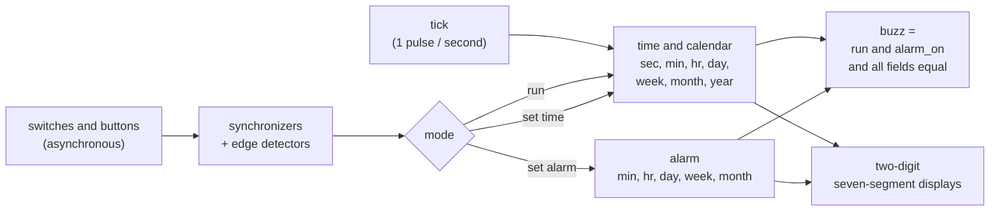

# Single-clock alarm clock with decimal time and calendar

[](https://github.com/r800360/alarm-clock-sv/actions/workflows/ci.yml)
[](LICENSE)

A fully synchronous alarm clock in one parameterized SystemVerilog module. It offers:
* conventional (60 s / 60 min / 24 h) or **decimal** (100 s / 100 min / 10 h) time;
* an optional **decimal calendar**: 10-day weeks, 3-week months, 12 months, then 5 complementary days (6 in leap
  years);
* an alarm, and seven-segment outputs.

It is verified against two independent references, including a four-year simulation, and its safety invariants are
proven unbounded.



**Modes.** With both switches equal, the clock runs on `tick`. With only `setup_time` on, the time freezes and each
button press advances one field, without carrying into the next. With only `setup_alarm` on, the time freezes, the
buttons set the alarm, and the display shows it.

## Design choices

* **One clock, enables, synchronous carries.** Every field updates on the same edge, so `9:99:99 → 0:00:00`, or a
  whole year rollover, happens in one step. There are no derived clocks.
* **Clean inputs.** Every switch and button is synchronized. Every button press is edge-detected, so holding a button
  counts once.
* **Calendar terminal counts.** The last day of a period depends on the month and the year: 9 in a week, 4 or 5 in the
  complementary days. Terminal counts use `>=`, so a day that was set too high still wraps cleanly.

## Results

| Check | Result |
|---|---|
| Field model and arithmetic decomposition, every tick, three configurations (Icarus and Verilator) | all pass: 18 checks with the calendar, 13 without |
| **Four calendar years from reset** (146 100 000 ticks, Verilator) | fields equal the decomposition |
| PDR proofs: field ranges, time frozen while setting the alarm, alarm changes only while being set, buzz conditions, one tick = one second | **proved unbounded** in all three configurations |
| Three broken designs | each gives a counterexample |
| Synthesis (Yosys, generic gates): conventional / decimal / decimal + calendar | 440 / 450 / 714 cells |

## Reproduce

Every result comes from a pinned toolchain: Ubuntu 26.04 with Icarus Verilog 12.0, Verilator 5.032 and Yosys 0.52
(see [`scripts/install-tools.sh`](scripts/install-tools.sh)).

```bash
docker build -t alarm-clock-sv .
docker run --rm -u "$(id -u):$(id -g)" -v "$PWD":/work alarm-clock-sv make ci     # ~2 minutes
docker run --rm -u "$(id -u):$(id -g)" -v "$PWD":/work alarm-clock-sv make full   # + the four-year run
```

`build/SUMMARY.md` collects every result. The targets are `lint`, `sim`, `long` (four years), `formal` and `synth`.
* The *CI* workflow runs `make ci` on every push and uploads `build/`.
* *Full verification* runs `make full` on demand or for a `v*` tag, and a tag also publishes a release.

## Repository map

```
rtl/alarm_clock.sv     the design (parameters DECIMAL, CALENDAR, SYNC)
tb/tb_alarm_clock.sv   self-checking testbench (CFG = 1 / 2 / 3; LONG for four years), tb_common.svh
formal/                invariants, pdr.sh, run_formal.sh (proofs and negative controls)
docs/                  DESIGN.md (interface, calendar rules), VERIFICATION.md (every check, tool invocations)
```

Origin: this design began as an assignment in a university digital-design course, built from provided counters with
derived clocks. This repository is an independent single-clock SystemVerilog re-implementation, extended with the
calendar and with formal proofs.

MIT License, © 2026 Rohan Sachdeva.
