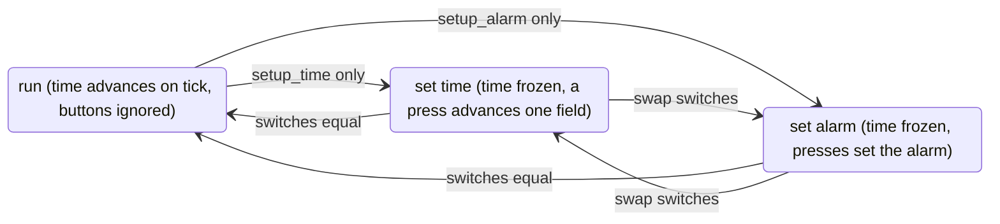

# Design

## Interface

```systemverilog
module alarm_clock #(DECIMAL = 0, CALENDAR = 0, SYNC = 2) (
  input  clk, rst,                                        // one clock; synchronous reset
  input  tick,                                            // one-cycle pulse per second (from a divider)
  input  setup_time, setup_alarm, alarm_on,               // switches (asynchronous)
  input  btn_min, btn_hr, btn_day, btn_week, btn_month,   // push-buttons (asynchronous)
  output sec, min, hr, day, week, month, year,            // the time
  output alarm_min, alarm_hr, alarm_day, alarm_week, alarm_month,
  output buzz,
  output seg_sec, seg_min, seg_hr, seg_day, seg_week, seg_month, seg_year);   // two digits x 7 segments each
```

## Modes



The mode is decoded from the *synchronized* switches:
* `run` when they are equal;
* `set time` when only `setup_time` is on;
* `set alarm` when only `setup_alarm` is on.

`buzz` is on in run mode when `alarm_on` is set and every alarm field equals the time's: minute and hour, plus day,
week and month with the calendar. While the alarm is being set, the display shows the alarm, with seconds and year as
00.

## Counting

* **One clock and enables.** `tick` is an enable. Each carry is a combinational AND of terminal counts, so every field
  that wraps does so on the same edge.
* **Setting.** In set-time mode, a press advances its field by one and wraps without carrying. The year cannot be set.
* **The calendar.** A day's terminal count is 9 in a normal week, 4 in the complementary days, and 5 in those of a year
  with year mod 4 = 3. The complementary days follow month 11 as "month 12" and end the year. Terminal counts use
  `>=`, so a day set above its month's last day (setting the day before the month allows that) wraps at the end of
  that day.
* **Inputs.** Each switch and button passes through a `SYNC`-stage synchronizer. Each button then passes through a
  rising-edge detector, so a press held for any number of cycles counts once.
* **Display.** Each value 0–99 is split into two digits, each decoded to seven segments (gfedcba, active high).

## Synthesis (`make synth`)

Yosys `synth -flatten; abc -g gates`; the netlists are in `build/synth/`:

| Configuration | Flip-flops | Two-input gates | Inverters | Total |
|---|--:|--:|--:|--:|
| conventional | 41 | 393 | 6 | 440 |
| decimal | 41 | 404 | 5 | 450 |
| decimal + calendar | 74 | 628 | 12 | 714 |
